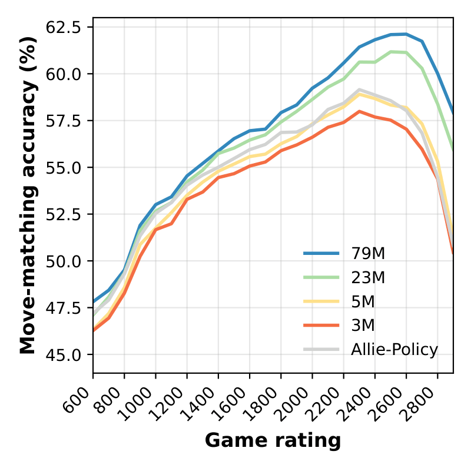

# Maia-3: human-like chess play and analysis engine

> **Personal copy and license note:** This is a privately maintained copy of
> the Maia-3 project from [CSSLab/maia3](https://github.com/CSSLab/maia3), not
> the upstream project. The code is distributed under the GNU Affero General
> Public License v3.0 (AGPL-3.0); see [LICENSE](LICENSE) and retain its notices.
> Private use alone generally does not require publishing your changes, but
> providing access to a modified version over a network can trigger AGPL source
> availability requirements. Model weights and other assets may have separate
> terms.

## [models](https://huggingface.co/collections/MaiaChess/maia3)/[code](https://github.com/CSSLab/maia-chess)/[paper](https://arxiv.org/abs/2605.19091)/[website](https://maiachess.com)

[](https://huggingface.co/collections/MaiaChess/maia3)
[](https://arxiv.org/abs/2605.19091)


Maia-3 is a family of chess transformer models for predicting human moves across
skill levels. This repository contains the inference code needed to run the
released Maia-3 weights as a UCI chess engine.



Maia3 is built on Chessformer, our novel transformer architecture for chess modeling. Read the paper here: [Chessformer: A Unified Architecture for Chess Modeling](https://arxiv.org/abs/2605.19091)

If you use Maia-3 in your work, please cite our paper:
```bibtex
@inproceedings{monroe2026chessformer,
title={Chessformer: A Unified Architecture for Chess Modeling},
author={Daniel Monroe and George Eilender and Philip Chalmers and Zhenwei Tang and Ashton Anderson},
booktitle={The Fourteenth International Conference on Learning Representations},
year={2026},
url={https://openreview.net/forum?id=2ltBRzEHyd}
}
```

## Install

```bash
git clone https://github.com/CSSLab/maia3.git
cd maia3
python -m pip install .
```

For development, install in editable mode:

```bash
python -m pip install -e .
```

You can also run directly from the repo without installing:

```bash
python -m maia3.uci --help
```

## Quick Start

Run the 5M Maia3 model as a UCI engine:

```bash
maia3-5m
```

The first run downloads the checkpoint from Hugging Face and caches it locally.
After that, the same command reuses the cached file.

You can pre-download the default 5M model before opening a chess GUI:

```bash
maia3-cache
```

You can also pass the Hugging Face model URL directly:

```bash
maia3-uci --model https://huggingface.co/UofTCSSLab/Maia3-79M
```

List built-in aliases:

```bash
maia3-uci --list-models
```

## Run the Local OTB Game

From the repository root, create a virtual environment and install the project
and its dependencies. The commands below are for Windows PowerShell:

```powershell
py -m venv .venv
.\.venv\Scripts\python.exe -m pip install --upgrade pip
.\.venv\Scripts\python.exe -m pip install -e .
```

The local game script uses the 79M model and runs with local files only, so
download its checkpoint before starting a game. This requires an internet
connection the first time and enough disk space for the model:

```powershell
.\.venv\Scripts\python.exe -m maia3.cache --model maia3-79m
```

Start the game from the repository root:

```powershell
.\.venv\Scripts\python.exe .\play_maia.py
```

After you enter the Elo ratings and color, the script loads Maia before asking
for your first move. Startup may take a little while.

In the Chessground browser interface, use the cog to choose a board and piece
set. Changes apply immediately and are saved in the current browser.
The Mosaic board repeats the supplied textured checkerboard image.

The Wood, Marble and Blue marble board images are from the
[Lichess board collection](https://github.com/lichess-org/lila/tree/master/public/images/board),
by the Lichess authors and pirouetti, under AGPL-3.0-or-later. The Fantasy,
Spatial and Celtic pieces are by Maurizio Monge, from
[Lichess](https://github.com/lichess-org/lila/tree/master/public/piece) and
[chess-art](https://github.com/maurimo/chess-art), under the
[MIT license](frontend/public/licenses/chess-art.txt). Lichess documents these
licenses in its [copying notes](https://github.com/lichess-org/lila/blob/master/COPYING.md).
The unmodified [Maestro pieces](https://github.com/lichess-org/lila/tree/master/public/piece/maestro)
are by sadsnake1 and licensed under
[CC BY-NC-SA 4.0](https://creativecommons.org/licenses/by-nc-sa/4.0/),
which permits noncommercial use and requires attribution and share-alike for
adaptations.

### Run the Chessground browser tests

The Chessground frontend has deterministic Playwright tests that use a fake
engine and temporary storage. They do not download a model or modify the
real `games` or ladder files:

```powershell
cd frontend
npm ci
npm run build
npx playwright install chromium
npx playwright test
```

Enter your Maia Elo, your Elo, and the color you want to play. Enter moves in
standard algebraic notation (such as `e4`) or UCI notation (such as `e2e4`).
Type `help` at any prompt to see the available commands: `undo` takes back a
turn, `resign` (or `concede`) resigns, and `q` (or `quit`/`exit`) quits. While
Maia is thinking, `go` skips the remaining delay and makes her play immediately.
Completed games are saved as PGN files in the `games` folder. Quitting or
interrupting an unfinished game does not save it.
A system notification sound plays after Maia makes a move on Windows.

## Play from a Phone on Local Wi-Fi

The web interface runs as a separate application and leaves the terminal
workflow intact. Both interfaces use the shared game logic in `maia_game.py`
for engine setup, move validation, Maia's move selection and think-time, and
PGN generation.

On a new Windows PC, install [Git for Windows](https://git-scm.com/download/win)
and [Python 3.12](https://www.python.org/downloads/windows/) with the Python
launcher, then clone this repository copy (not the upstream Maia-3 repository):

```powershell
git clone https://github.com/tvmolin/maia-3-otb-play.git
cd maia-3-otb-play
py -3.12 -m venv .venv
.\.venv\Scripts\python.exe -m pip install --upgrade pip
.\.venv\Scripts\python.exe -m pip install -e .
```

For an existing checkout, install or refresh the project dependencies with:

```powershell
.\.venv\Scripts\python.exe -m pip install -e .
```

The chat app uses the Maia 79M checkpoint in local-files-only mode. Download it
once on each new PC while connected to the internet:

```powershell
.\.venv\Scripts\python.exe -m maia3.cache --model maia3-79m
```

Run the chat API tests to verify the Python setup:

```powershell
.\.venv\Scripts\python.exe -m unittest discover -s tests -p test_web_app.py
```

Start the web game from the repository root:

```powershell
.\.venv\Scripts\python.exe .\web_app.py
```

The server listens on port 5000 on all network interfaces. Find the PC's
local IPv4 address with `ipconfig`, then open `http://<PC-IP>:5000` in a phone
browser on the same Wi-Fi network. Wait until the server says it is starting
before connecting; it loads Maia first.

### Local Whisper speech input

The chat page can record a spoken move and process it entirely on this PC.
Whisper transcribes the recording; the default `small` model is downloaded and
cached locally on first use, which requires internet access. The recording is
uploaded only to this PC.
Set `WHISPER_MODEL` before starting the app to choose another
[faster-whisper model](https://github.com/SYSTRAN/faster-whisper#model-sizes).
Recordings larger than 25 MB are rejected.

The app explicitly runs Whisper on the NVIDIA GPU and selects the fastest
supported CUDA compute type, preferring FP16 and then INT8. The GTX 1080 Ti
does not report efficient FP16 support to CTranslate2; the tested build runs
it as `int8_float32` on CUDA. On Windows, faster-whisper also needs CUDA 12
cuBLAS and cuDNN 9 DLLs available on `PATH`; the Python package alone does not
install these system libraries. Follow the
[faster-whisper GPU setup instructions](https://github.com/SYSTRAN/faster-whisper#gpu)
for the matching CUDA/cuDNN libraries. There is no automatic CPU fallback:
if GPU initialization fails, the transcription API reports an error instead.
faster-whisper decodes browser recordings with its bundled PyAV, so a separate
FFmpeg installation is not needed.
Install a current [NVIDIA driver](https://www.nvidia.com/Download/index.aspx)
compatible with the GPU and CUDA-enabled PyTorch build used by Maia. Check that
PyTorch sees the GPU with:

```powershell
.\.venv\Scripts\python.exe -c "import torch; print(torch.cuda.is_available()); print(torch.cuda.get_device_name(0) if torch.cuda.is_available() else 'No CUDA GPU detected')"
```

If this reports `False`, install the matching Windows CUDA build of PyTorch
using the [official PyTorch selector](https://pytorch.org/get-started/locally/)
in this virtual environment. This is separate from the CUDA 12 cuBLAS and
cuDNN 9 DLLs required by faster-whisper.

### Local chess phrase interpretation

Install Ollama and download the selected local model once:

```powershell
winget install --id Ollama.Ollama --exact
ollama pull qwen2.5:7b
```

Ollama must be running locally at `127.0.0.1:11434`; model downloads require
internet access, but move transcripts and board positions are sent only to
that local Ollama service. Set `OLLAMA_MODEL` before starting the app to use a
different model already installed in Ollama.

After starting a game, tap **Speak move** to record. Tap **Send move** to stop
recording and submit it: Whisper transcribes, Ollama interprets the phrase
using the current position and its legal moves, and the app validates the UCI
result before passing it through the normal command and engine flow. A
successful interpretation immediately commits the move and requests Maia's
reply; there is no separate transcript review in this workflow. If speech is
unclear, Ollama is unavailable, or its result is not legal, the app reports an
error without changing the board so the player can repeat the move.

### Secure phone microphone access

Browsers require a secure context for microphone access, so
`http://<PC-IP>:5000` will not allow recording from the phone.

For an iPhone on the same Wi-Fi, you can use a private local certificate
authority instead of Tailscale. Install [mkcert](https://github.com/FiloSottile/mkcert)
on Windows with WinGet, then open a new PowerShell window. From the repository
root, set the PC's current LAN IP address and create a private CA, an HTTPS
certificate, and a copy of only the public CA certificate for transfer to the
phone:

```powershell
winget install --id FiloSottile.mkcert --exact
$certDir = Join-Path $env:LOCALAPPDATA "Maia-OTB\certs"
$phoneDir = Join-Path $env:LOCALAPPDATA "Maia-OTB\iphone"
$caDir = Join-Path $env:LOCALAPPDATA "Maia-OTB\ca"
New-Item -ItemType Directory -Force -Path $certDir, $phoneDir, $caDir | Out-Null
$env:CAROOT = $caDir
$env:TRUST_STORES = "system"
mkcert -install
mkcert -cert-file "$certDir\server.pem" -key-file "$certDir\server-key.pem" 192.168.1.50 localhost 127.0.0.1
$env:MAIA_CA_DER = Join-Path $phoneDir "rootCA.cer"
certutil.exe -decode "$caDir\rootCA.pem" $env:MAIA_CA_DER
$env:MAIA_PROFILE_PATH = Join-Path $phoneDir "Maia-OTB-Local-CA.mobileconfig"
@'
import os
import plistlib
import uuid
from pathlib import Path

certificate = Path(os.environ["MAIA_CA_DER"]).read_bytes()
profile = {
    "PayloadContent": [{
        "PayloadContent": certificate,
        "PayloadDisplayName": "Maia OTB Local HTTPS CA",
        "PayloadIdentifier": "local.maiaotb.certificate-authority",
        "PayloadType": "com.apple.security.root",
        "PayloadUUID": str(uuid.uuid4()).upper(),
        "PayloadVersion": 1,
    }],
    "PayloadDisplayName": "Maia OTB Local HTTPS CA",
    "PayloadIdentifier": "local.maiaotb.https",
    "PayloadOrganization": "Local development on this PC",
    "PayloadRemovalDisallowed": False,
    "PayloadType": "Configuration",
    "PayloadUUID": str(uuid.uuid4()).upper(),
    "PayloadVersion": 1,
}
Path(os.environ["MAIA_PROFILE_PATH"]).write_bytes(
    plistlib.dumps(profile, fmt=plistlib.FMT_XML)
)
'@ | .\.venv\Scripts\python.exe -
```

Replace `192.168.1.50` with the PC's LAN IP from `ipconfig`. The phone and PC
must be on the same trusted Wi-Fi network; reserve the IP in the router or
reissue the certificate if the address changes. Once those certificate files
exist, the app automatically uses them on startup; just start the app as usual:

```powershell
.\.venv\Scripts\python.exe .\web_app.py
```

To transfer the public CA profile over the local network, stop the chat server
if it is running, then run this temporary profile server in PowerShell:

```powershell
$env:PROFILE_PATH = Join-Path $phoneDir "Maia-OTB-Local-CA.mobileconfig"
@'
from http.server import BaseHTTPRequestHandler, ThreadingHTTPServer
from pathlib import Path
import os

profile = Path(os.environ["PROFILE_PATH"]).read_bytes()

class ProfileHandler(BaseHTTPRequestHandler):
    def do_GET(self):
        if self.path != "/Maia-OTB-Local-CA.mobileconfig":
            self.send_error(404)
            return
        self.send_response(200)
        self.send_header("Content-Type", "application/x-apple-aspen-config")
        self.send_header("Content-Length", str(len(profile)))
        self.end_headers()
        self.wfile.write(profile)

ThreadingHTTPServer(("0.0.0.0", 5000), ProfileHandler).serve_forever()
'@ | .\.venv\Scripts\python.exe -
```

In Safari on the iPhone, open
`http://<PC-LAN-IP>:5000/Maia-OTB-Local-CA.mobileconfig`, download the profile,
then stop the temporary server with Ctrl+C. In the iPhone Files app, open
Downloads and tap the `.mobileconfig` file. Install the profile from Settings
when prompted. Alternatively, transfer only
`%LOCALAPPDATA%\Maia-OTB\iphone\Maia-OTB-Local-CA.mobileconfig` to the phone
using iCloud Drive. Do **not** copy or share `rootCA-key.pem` or
`server-key.pem`. Then go to **Settings > General > About > Certificate Trust
Settings** and enable full trust for the new root certificate. Open
`https://<PC-LAN-IP>:5000` in Safari or Firefox on the iPhone. The local CA's
private key remains on the PC; remove the trusted root from the iPhone and
Windows certificate store when you no longer need this setup.

Alternatively, install Tailscale on the PC and phone, sign both into the same
tailnet, enable MagicDNS and HTTPS certificates in the tailnet DNS settings,
and proxy the app through Tailscale Serve:

```powershell
$env:MAIA_HOST = "127.0.0.1"
.\.venv\Scripts\python.exe .\web_app.py
```

In another PowerShell window:

```powershell
tailscale serve --bg http://127.0.0.1:5000
tailscale serve status
```

Open the displayed `https://<PC-name>.<tailnet>.ts.net` address on the phone
with Tailscale connected. Tailscale HTTPS certificates publicly log the PC's
machine name; avoid a name you do not want public. Do not expose port 5000 to
the internet or use Tailscale Funnel for this app.

For direct plain-HTTP access by PC IP only (which does not enable phone
recording), if Windows Firewall blocks the connection, open PowerShell as
Administrator and add an inbound rule for port 5000 on private networks only.
Restricting it to the local subnet allows devices on your Wi-Fi to connect
without opening the port to the public internet. This rule is not needed for
the loopback/Tailscale HTTPS setup above:

```powershell
New-NetFirewallRule -DisplayName "Maia 3 local web app (TCP 5000)" `
  -Direction Inbound -Action Allow -Protocol TCP -LocalPort 5000 `
  -Profile Private -RemoteAddress LocalSubnet
```

Make sure the PC's Wi-Fi network is set to the **Private** network profile in
Windows Settings under **Network & internet**. In `ipconfig`, use the IPv4
address listed under the Wi-Fi adapter (not `127.0.0.1`) in the phone's browser.
Both devices must be on the same non-guest Wi-Fi network; guest networks or
router access-point isolation can prevent devices from reaching each other.
To remove the rule later, run this in an Administrator PowerShell:

```powershell
Remove-NetFirewallRule -DisplayName "Maia 3 local web app (TCP 5000)"
```

Choose White or Black and enter both Elo ratings when starting. Defaults match
the terminal prompts (Maia 800, player 760). If you choose Black, Maia makes
the opening move first. Enter moves in standard algebraic notation (such as
`e4`) or UCI notation (such as `e2e4`). The web interface also accepts the
terminal commands `help`, `undo`, `resign`/`concede`, `q`/`quit`/`exit`, and
`go` (during Maia's think delay). Help and Go controls remain available while
Maia is thinking. Maia uses the same uncertainty-based think time and shared
game logic as the terminal version. The web game runs independently from any
terminal game. Its PGN is written to the `games` folder when the game ends,
including by resignation; stopping the server during an unfinished game does
not save it. PGNs for newly played web games include each move's elapsed time
as a standard `[%emt ...]` annotation. Use **Copy PGN** to copy the game
notation.
If the browser blocks clipboard access over local HTTP, the PGN is displayed
selected so you can copy it manually.
Use **New Game** to discard an unfinished game and choose a side again without
restarting the server or reloading the engine. Start a new game after Maia has
finished her current turn (or use `go` to skip the remaining think delay).

The HTTP API supports `POST /api/start` with `{"color":"white","maia_elo":800,"player_elo":760}` (use `"black"` to play Black), `GET /api/history`, and `POST /api/command` with `{"text":"e4"}` or a terminal command such as `{"text":"undo"}`. `POST /api/new-game` saves a completed game (if not already saved), discards an unfinished one, and returns to side/rating selection. The `POST /api/move` route remains available and accepts either `{"move":"e4"}` or a command string.

## Play Maia on a Chessground Board

The separate Chessground interface is for playing Maia on this computer; it
does not replace or change the OTB web app above.

### macOS (Intel and Apple Silicon)

Install Node.js/npm and [uv](https://docs.astral.sh/uv/getting-started/installation/)
first. `uv` installs a Python runtime and creates the project environment
without changing the system Python. Reopen the terminal after installing `uv`
if the `uv` command is not yet on your PATH. From the repository root:

```sh
curl -LsSf https://astral.sh/uv/install.sh | sh
uv python install 3.12
uv venv --clear --python 3.12 .venv
```

Install the project dependencies. On Apple Silicon:

```sh
uv pip install --python .venv/bin/python -e .
```

On Intel Macs, use the NumPy constraint shown here:

```sh
uv pip install --python .venv/bin/python -e . 'numpy<2'
```

Intel macOS currently has no PyTorch wheel for Python 3.13; use Python 3.12.
The latest Intel macOS PyTorch wheel is 2.2.2, so pin NumPy below 2 for
compatibility. The model includes an RMSNorm fallback for that PyTorch version.

Build the frontend, download the Maia 79M checkpoint (about 300 MB; first run
requires an internet connection), and start the app:

```sh
npm --prefix frontend ci
npm --prefix frontend run build
.venv/bin/python -m maia3.cache --model maia3-79m
.venv/bin/python chessground_app.py
```

The app opens `http://127.0.0.1:5001` in the browser and listens on loopback
only.

### Windows

Install [Node.js LTS](https://nodejs.org/en/download/) (which includes npm)
before building the frontend.

Build the frontend once from the repository root:

```powershell
npm --prefix frontend ci
npm --prefix frontend run build
```

Install the Python project if needed, pre-cache the model, and start the local
app:

```powershell
.\.venv\Scripts\python.exe -m pip install -e .
.\.venv\Scripts\python.exe -m maia3.cache --model maia3-79m
.\.venv\Scripts\python.exe .\chessground_app.py
```

The app opens `http://127.0.0.1:5001` in the browser and listens on loopback
only. Your Blitz and Rapid ratings each start at 800. Choose one of the four
time controls—Blitz 3+2 or 5+5, or Rapid 15+10 or 20+10—then select
**Find match**. Choose Random, White, or Black for your piece color. Each match
uses your selection (Random chooses a color automatically), a Maia rating
within 100 points of your rating in that category, and a Maia temperature from
0.5–0.9.
Move pieces on the board to play. While Maia is thinking, you can queue one
premove; it is sent only if it remains legal after Maia's reply. Find another
match after a game to return to the matchmaking screen. Finished match results
and category-specific rating changes (K=40) are stored in
`games/ladder-ratings.json` and persist between app runs. Each match gets a
randomly generated, unique Maia username, shown alongside the board and saved
in match history and PGN. Draws count as half a point.
Open **Profile** to switch between your Blitz and Rapid rating graphs and match
histories. Completed PGNs are saved with each match-history entry and can be
copied from its row. Use **Delete game** to remove a match from your local
history and recalculate the category rating from the remaining matches. This
does not delete a game already imported to Lichess. Unrated games remain in the
history but do not affect ratings. The backend validates moves and remains the
source of truth for game state. Your accepted move appears in the move list and
captured-piece display before Maia finishes thinking. If the engine fails, your
move is kept and the clock is paused; use **Retry Maia** or **Undo** to continue.
The Chessground `POST /api/move` response contains the accepted player position
and, unless the game has ended, `maia_thinking: true`; `GET /api/state` reports
Maia's subsequent move or an engine error. `POST /api/retry-maia` retries a
failed engine turn.
The app uses the 79M model, which must be downloaded before play. The available
game clocks are Blitz 3+2 and 5+5, and Rapid 15+10 and 20+10.
Both clocks are enforced by the server, including Maia's engine and think time.

### Automatic Lichess imports

To automatically import completed games, create a
[Lichess personal access token](https://lichess.org/account/oauth/token) and
put it in a `.env` file in the repository root:

```text
LICHESS_API_TOKEN=your-token-here
```

The import endpoint requires no extra token scopes. A `LICHESS_API_TOKEN`
environment variable takes precedence over `.env`. Keep the token secret;
`.env` is ignored by Git. Restart the app after changing the token. Without a
token, importing is disabled. Install the project dependencies again after
updating the project to add `.env` support.

The Chessground, local web, and terminal interfaces save completed games locally
first and then import them in the background. Chessground's Profile updates
automatically to show the Lichess analysis link when an import finishes.
Imported games appear in your Lichess imported-games
collection. Unfinished games are not imported.

For an older match that was not automatically imported, use **Import to
Lichess** in its Profile row. The button requires a configured token and a
saved PGN. If the PGN file is missing but the match history contains its PGN,
the app restores a local copy before importing it.

Import failures are logged and shown on the Chessground profile, where they can
be retried. A timeout or interrupted import may have succeeded on Lichess even
if the app could not confirm it; check your imported games before retrying to
avoid duplicates. Import status is stored beside the PGN in the `games` folder.
Lichess's public import API does not request full server-side computer analysis:
open the link and request it on Lichess. Imports are subject to Lichess rate
limits and are not private by default.

The Chessground interface uses the Tatiana chess-piece artwork by sadsnake1,
from [Lichess](https://github.com/lichess-org/lila/tree/master/public/piece/tatiana),
under the [CC BY-NC-SA 4.0 license](https://creativecommons.org/licenses/by-nc-sa/4.0/).
The artwork is for non-commercial use and must be shared under the same license.

## Models

The built-in aliases and preset commands apply the correct architecture settings
automatically.

| Model | Best for | Hugging Face repo | Command |
| --- | --- | --- | --- |
| 5M | First try, CPU, chess GUIs | `UofTCSSLab/Maia3-5M` | `maia3-5m` |
| 23M | Better accuracy | `UofTCSSLab/Maia3-23M` | `maia3-23m` |
| 79M | Best accuracy | `UofTCSSLab/Maia3-79M` | `maia3-79m` |
| 3M ablation | Paper ablation | `UofTCSSLab/Maia3-ablate-3M` | `maia3-3m-ablation` |

Short aliases also work:

```bash
maia3-uci --model 3m
maia3-uci --model 5m
maia3-uci --model 23m
maia3-uci --model 79m
```

`maia3-3m` is kept as a compatibility alias for `maia3-3m-ablation`.

Cache a larger model before opening a GUI:

```bash
maia3-cache --model maia3-79m
```

If a Hugging Face repository contains more than one checkpoint file, choose one:

```bash
maia3-uci --model UofTCSSLab/Maia3-79M --checkpoint-filename maia3-79m.pt
```

To use a local checkpoint while still applying a built-in config:

```bash
maia3-uci --model maia3-79m --checkpoint-path /path/to/maia3-79m.pt
```

Pass local files with `--checkpoint-path`, not `--model`, so Maia3 knows
whether to use a built-in architecture preset or your custom architecture flags.

To use a fully custom checkpoint, pass the checkpoint and the matching
architecture flags:

```bash
maia3-uci --checkpoint-path /path/to/custom.pt \
  --history 8 --use-padding \
  --dim-vit 256 --head-hid-dim 256 --num-heads 8 \
  --gab-per-square-dim 0 --gab-gen-size 64 --gab-intermediate-dim 64
```

## UCI Options

The engine reads UCI commands from stdin and writes responses to stdout. Any
UCI-aware chess GUI or wrapper can drive it.

For manual testing, use the standard UCI position forms:
`position startpos moves e2e4` or `position fen <six-field FEN>`.

User-facing options:

- `Elo`: set both player and opponent Elo.
- `SelfElo`: set the side-to-move Elo.
- `OppoElo`: set the opponent Elo.
- `Temperature`: move sampling temperature. `0` means argmax.
- `TopP`: nucleus sampling threshold. `1.0` disables top-p filtering.
- `MultiPV`: number of likely human moves to show as UCI info lines.

## Engine Command-Line Options

The options below are passed when launching `maia3-uci` (or a model preset
command). They are separate from the UCI options above, which a chess GUI can
change after the engine starts. Defaults shown here are the parser defaults;
selecting a built-in model with `--model` applies that model's architecture
preset and may replace architecture and input defaults.

Options with both hyphenated and underscored spellings accept either form.
For example, `--cache-dir` and `--cache_dir` are equivalent. Boolean options
listed with on/off forms accept `--no-...` variants as well.

Use `-h` or `--help` to display the command-line help and exit.

### Model and checkpoint

| Option | Default | Description |
| --- | --- | --- |
| `--model` | none | Built-in model alias, Hugging Face repository ID, or Hugging Face URL. |
| `--checkpoint`, `--checkpoint-path`, `--checkpoint_path` | none | Path to a local checkpoint. Combine with `--model` to use that model's architecture preset; omit `--model` for a custom architecture. |
| `--checkpoint-filename`, `--checkpoint_filename` | automatic | Select a particular checkpoint file in a Hugging Face repository when it cannot be selected automatically. |
| `--cache-dir`, `--cache_dir` | Hugging Face default | Directory for the Hugging Face download cache. |
| `--revision` | repository default | Hugging Face branch, tag, or commit to use. |
| `--local-files-only`, `--local_files_only` | off | Use only files already in the Hugging Face cache; do not download missing files. |
| `--force-download`, `--force_download` | off | Force a fresh download of the checkpoint. |
| `--hf-token`, `--hf_token` | none | Hugging Face access token, for example to access a private model repository. |
| `--trust-checkpoint`, `--trust_checkpoint` | off | Allow unsafe pickle loading for a legacy checkpoint. Use only with a checkpoint you trust. |
| `--list-models`, `--list_models` | off | Print the built-in model aliases and exit. |

### Runtime and move selection

| Option | Default | Description |
| --- | --- | --- |
| `--device` | `cuda` if available, otherwise `cpu` | Device on which to load and run the model. |
| `--seed` | `42` | Seed the random-number generators used by inference. |
| `--elo` | `1500` | Initial Elo for both players; the UCI `Elo`, `SelfElo`, and `OppoElo` options can change it. |
| `--temperature` | `1.0` | Move-sampling temperature. `0` or less selects the highest-scoring legal move. |
| `--top-p`, `--top_p` | `1.0` | Nucleus-sampling threshold; `1.0` disables top-p filtering. |
| `--multipv`, `--multi-pv` | `5` | Number of candidate moves to report in UCI MultiPV info lines; values are limited to 1–20. |
| `--use-uci-history`, `--use_uci_history` | off | Rebuild move history from moves in UCI `position` commands. When disabled, the current position is repeated to fill the model's history input. |

### Input and architecture

These settings describe the checkpoint's expected input and architecture.
When using a custom checkpoint, set them to match that checkpoint.

| Option | Default | Description |
| --- | --- | --- |
| `--history` | `8` | Number of board positions in the model input history. |
| `--use-padding`, `--use_padding` | off | Enable the checkpoint's configured input-padding behavior. Built-in presets enable it. |
| `--include-time-info`, `--include_time_info` / `--no-include-time-info`, `--no-include_time_info` | off | Configure whether the model input includes time features. The UCI engine supplies zero-valued time data. |
| `--dim-emb`, `--dim_emb` | `128` | Embedding dimension. |
| `--dim-vit`, `--dim_vit` | `192` | Transformer/ViT hidden dimension. |
| `--num-blocks`, `--num_blocks` | `8` | Number of transformer blocks. |
| `--num-heads`, `--num_heads` | `6` | Number of attention heads. |
| `--mlp-ratio`, `--mlp_ratio` | `2.0` | MLP size relative to the transformer dimension. |
| `--dropout` | `0.0` | Dropout probability configured for the model. |
| `--head-hid-dim`, `--head_hid_dim` | `192` | Hidden dimension of the prediction heads. |
| `--use-gab`, `--use_gab` / `--no-use-gab`, `--no-use_gab` | on | Enable or disable the GAB attention component. |
| `--gab-gen-size`, `--gab_gen_size` | `64` | GAB generator size. |
| `--gab-per-square-dim`, `--gab_per_square_dim` | `0` | GAB feature dimension per board square. |
| `--gab-intermediate-dim`, `--gab_intermediate_dim` | `64` | GAB intermediate dimension. |
| `--use-rms-norm`, `--use_rms_norm` / `--no-use-rms-norm`, `--no-use_rms_norm` | on | Enable or disable RMS normalization. |
| `--omit-qkv-biases`, `--omit_qkv_biases` / `--no-omit-qkv-biases`, `--no-omit_qkv_biases` | on | Omit or include query, key, and value projection biases. |
| `--activation` | `gelu` | MLP activation function; accepted values are `gelu` and `relu`. |
| `--use-relative-bias`, `--use_relative_bias` | off | Enable relative positional bias. |
| `--use-absolute-pe`, `--use_absolute_pe` | off | Enable absolute positional encoding. |
| `--use-amp`, `--use_amp` / `--no-use-amp`, `--no-use_amp` | on | Enable or disable automatic mixed precision. It is applied only when running on CUDA. |

## Use With Nibbler or Another Chess GUI

Maia3 can be added to any GUI that supports UCI engines, including Nibbler.

Recommended first setup:

```bash
python -m pip install .
maia3-cache --model maia3-5m
```

Then add a new UCI engine in your GUI:

| Setting | Value |
| --- | --- |
| Engine executable | `maia3-5m` |
| Arguments | none |

If you use one of the preset executables (`maia3-5m`, `maia3-23m`, or
`maia3-79m`), leave the arguments field empty. Do not add `--model` or point
Nibbler at a `.pt` checkpoint file.

If you see an error about local checkpoint files needing `--checkpoint-path`,
the GUI is passing an executable or checkpoint path as an argument. Clear the
arguments field and keep only the preset executable selected.

If your GUI asks for a full path to the executable, find it with:

```bash
which maia3-5m
```

On Windows:

```powershell
where maia3-5m
```

You can use the larger models the same way by selecting `maia3-23m` or
`maia3-79m` as the engine executable. Pre-caching is recommended because some
GUIs time out if an engine downloads a checkpoint during startup.

Maia3 starts the UCI handshake before loading the model, then loads the
checkpoint on `isready` or `go`. During analysis it emits standard `MultiPV`
`info` lines with WDL values from Maia3's value head, then returns `bestmove`.
Those WDL values are human-game outcome predictions for the candidate line, not
Stockfish-style search evaluations. The centipawn field is a GUI compatibility
score derived from the WDL head, not a searched engine evaluation.

Launch with reconstructed move history:

```bash
maia3-uci --model maia3-79m --use-uci-history
```

Launch on CPU:

```bash
maia3-uci --model maia3-5m --device cpu --no-use-amp
```

By default, Maia3 only loads tensor state-dict checkpoints. If you need to load
an old pickled checkpoint from a source you trust, add `--trust-checkpoint`.

## Example via python-chess

```python
import chess
import chess.engine

eng = chess.engine.SimpleEngine.popen_uci([
    "maia3-uci",
    "--model", "maia3-5m",
    "--use-uci-history",
    "--elo", "1500",
])

board = chess.Board()
print(eng.play(board, limit=chess.engine.Limit(nodes=1)).move)
eng.close()
```

If the `maia3-uci` script is not on your `PATH`, use Python module execution:

```python
import sys

cmd = [sys.executable, "-m", "maia3.uci", "--model", "maia3-5m"]
```

## Legacy Entry Point

The old command still works from the repository root:

```bash
python code/uci.py --model maia3-5m
```

New integrations should prefer `maia3-uci` or `python -m maia3.uci`.
