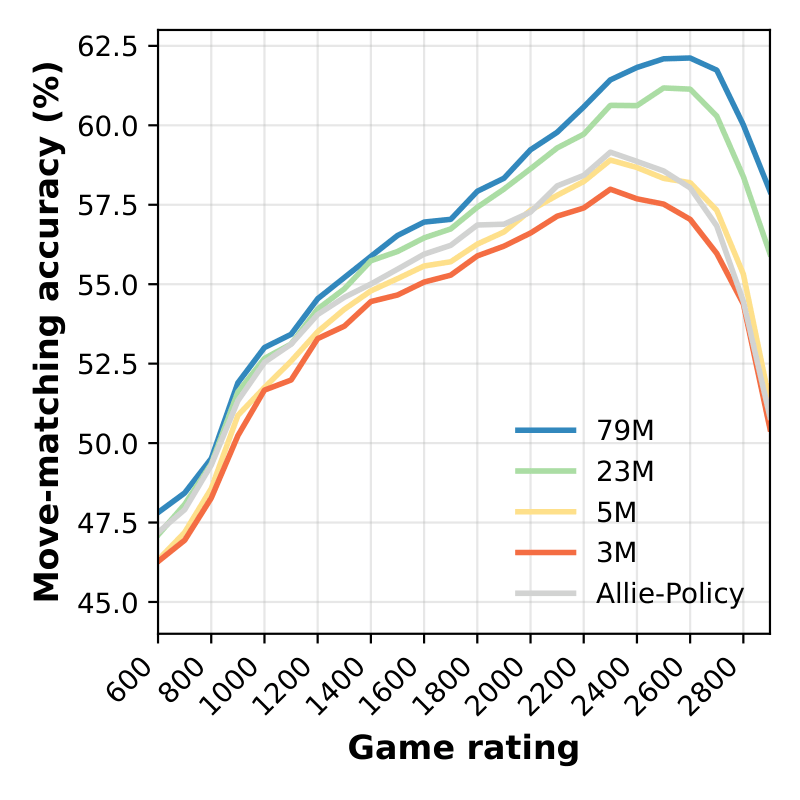

# Maia-3: human-like chess play and analysis engine

> **Personal copy and license note:** This is a privately maintained copy of
> the Maia-3 project from [CSSLab/maia3](https://github.com/CSSLab/maia3), not
> the upstream project. The code is distributed under the GNU Affero General
> Public License v3.0 (AGPL-3.0); see [LICENSE](LICENSE) and retain its notices.
> Private use alone generally does not require publishing your changes, but
> providing access to a modified version over a network can trigger AGPL source
> availability requirements. Model weights and other assets may have separate
> terms.

## [models](https://huggingface.co/collections/MaiaChess/maia3)/[code](https://github.com/CSSLab/maia-chess)/[paper](https://arxiv.org/abs/2605.19091)/[website](https://maiachess.com)

[](https://huggingface.co/collections/MaiaChess/maia3)
[](https://arxiv.org/abs/2605.19091)


Maia-3 is a family of chess transformer models for predicting human moves across
skill levels. This repository contains the inference code needed to run the
released Maia-3 weights as a UCI chess engine.



Maia3 is built on Chessformer, our novel transformer architecture for chess modeling. Read the paper here: [Chessformer: A Unified Architecture for Chess Modeling](https://arxiv.org/abs/2605.19091)

If you use Maia-3 in your work, please cite our paper:
```bibtex
@inproceedings{monroe2026chessformer,
title={Chessformer: A Unified Architecture for Chess Modeling},
author={Daniel Monroe and George Eilender and Philip Chalmers and Zhenwei Tang and Ashton Anderson},
booktitle={The Fourteenth International Conference on Learning Representations},
year={2026},
url={https://openreview.net/forum?id=2ltBRzEHyd}
}
```

## Install

```bash
git clone https://github.com/CSSLab/maia3.git
cd maia3
python -m pip install .
```

For development, install in editable mode:

```bash
python -m pip install -e .
```

You can also run directly from the repo without installing:

```bash
python -m maia3.uci --help
```

## Quick Start

Run the 5M Maia3 model as a UCI engine:

```bash
maia3-5m
```

The first run downloads the checkpoint from Hugging Face and caches it locally.
After that, the same command reuses the cached file.

You can pre-download the default 5M model before opening a chess GUI:

```bash
maia3-cache
```

You can also pass the Hugging Face model URL directly:

```bash
maia3-uci --model https://huggingface.co/UofTCSSLab/Maia3-79M
```

List built-in aliases:

```bash
maia3-uci --list-models
```

## Run the Local OTB Game

From the repository root, create a virtual environment and install the project
and its dependencies. The commands below are for Windows PowerShell:

```powershell
py -m venv .venv
.\.venv\Scripts\python.exe -m pip install --upgrade pip
.\.venv\Scripts\python.exe -m pip install -e .
```

The local game script uses the 79M model and runs with local files only, so
download its checkpoint before starting a game. This requires an internet
connection the first time and enough disk space for the model:

```powershell
.\.venv\Scripts\python.exe -m maia3.cache --model maia3-79m
```

Start the game from the repository root:

```powershell
.\.venv\Scripts\python.exe .\play_maia.py
```

After you enter the Elo ratings and color, the script loads Maia before asking
for your first move. Startup may take a little while.

Enter your Maia Elo, your Elo, and the color you want to play. Enter moves in
standard algebraic notation (such as `e4`) or UCI notation (such as `e2e4`).
Type `help` at any prompt to see the available commands: `undo` takes back a
turn, `resign` (or `concede`) resigns, and `q` (or `quit`/`exit`) quits. While
Maia is thinking, `go` skips the remaining delay and makes her play immediately.
The game is saved as a PGN file in the `games` folder when it ends or you quit.
A system notification sound plays after Maia makes a move on Windows.

## Models

The built-in aliases and preset commands apply the correct architecture settings
automatically.

| Model | Best for | Hugging Face repo | Command |
| --- | --- | --- | --- |
| 5M | First try, CPU, chess GUIs | `UofTCSSLab/Maia3-5M` | `maia3-5m` |
| 23M | Better accuracy | `UofTCSSLab/Maia3-23M` | `maia3-23m` |
| 79M | Best accuracy | `UofTCSSLab/Maia3-79M` | `maia3-79m` |
| 3M ablation | Paper ablation | `UofTCSSLab/Maia3-ablate-3M` | `maia3-3m-ablation` |

Short aliases also work:

```bash
maia3-uci --model 3m
maia3-uci --model 5m
maia3-uci --model 23m
maia3-uci --model 79m
```

`maia3-3m` is kept as a compatibility alias for `maia3-3m-ablation`.

Cache a larger model before opening a GUI:

```bash
maia3-cache --model maia3-79m
```

If a Hugging Face repository contains more than one checkpoint file, choose one:

```bash
maia3-uci --model UofTCSSLab/Maia3-79M --checkpoint-filename maia3-79m.pt
```

To use a local checkpoint while still applying a built-in config:

```bash
maia3-uci --model maia3-79m --checkpoint-path /path/to/maia3-79m.pt
```

Pass local files with `--checkpoint-path`, not `--model`, so Maia3 knows
whether to use a built-in architecture preset or your custom architecture flags.

To use a fully custom checkpoint, pass the checkpoint and the matching
architecture flags:

```bash
maia3-uci --checkpoint-path /path/to/custom.pt \
  --history 8 --use-padding \
  --dim-vit 256 --head-hid-dim 256 --num-heads 8 \
  --gab-per-square-dim 0 --gab-gen-size 64 --gab-intermediate-dim 64
```

## UCI Options

The engine reads UCI commands from stdin and writes responses to stdout. Any
UCI-aware chess GUI or wrapper can drive it.

For manual testing, use the standard UCI position forms:
`position startpos moves e2e4` or `position fen <six-field FEN>`.

User-facing options:

- `Elo`: set both player and opponent Elo.
- `SelfElo`: set the side-to-move Elo.
- `OppoElo`: set the opponent Elo.
- `Temperature`: move sampling temperature. `0` means argmax.
- `TopP`: nucleus sampling threshold. `1.0` disables top-p filtering.
- `MultiPV`: number of likely human moves to show as UCI info lines.

## Engine Command-Line Options

The options below are passed when launching `maia3-uci` (or a model preset
command). They are separate from the UCI options above, which a chess GUI can
change after the engine starts. Defaults shown here are the parser defaults;
selecting a built-in model with `--model` applies that model's architecture
preset and may replace architecture and input defaults.

Options with both hyphenated and underscored spellings accept either form.
For example, `--cache-dir` and `--cache_dir` are equivalent. Boolean options
listed with on/off forms accept `--no-...` variants as well.

Use `-h` or `--help` to display the command-line help and exit.

### Model and checkpoint

| Option | Default | Description |
| --- | --- | --- |
| `--model` | none | Built-in model alias, Hugging Face repository ID, or Hugging Face URL. |
| `--checkpoint`, `--checkpoint-path`, `--checkpoint_path` | none | Path to a local checkpoint. Combine with `--model` to use that model's architecture preset; omit `--model` for a custom architecture. |
| `--checkpoint-filename`, `--checkpoint_filename` | automatic | Select a particular checkpoint file in a Hugging Face repository when it cannot be selected automatically. |
| `--cache-dir`, `--cache_dir` | Hugging Face default | Directory for the Hugging Face download cache. |
| `--revision` | repository default | Hugging Face branch, tag, or commit to use. |
| `--local-files-only`, `--local_files_only` | off | Use only files already in the Hugging Face cache; do not download missing files. |
| `--force-download`, `--force_download` | off | Force a fresh download of the checkpoint. |
| `--hf-token`, `--hf_token` | none | Hugging Face access token, for example to access a private model repository. |
| `--trust-checkpoint`, `--trust_checkpoint` | off | Allow unsafe pickle loading for a legacy checkpoint. Use only with a checkpoint you trust. |
| `--list-models`, `--list_models` | off | Print the built-in model aliases and exit. |

### Runtime and move selection

| Option | Default | Description |
| --- | --- | --- |
| `--device` | `cuda` if available, otherwise `cpu` | Device on which to load and run the model. |
| `--seed` | `42` | Seed the random-number generators used by inference. |
| `--elo` | `1500` | Initial Elo for both players; the UCI `Elo`, `SelfElo`, and `OppoElo` options can change it. |
| `--temperature` | `1.0` | Move-sampling temperature. `0` or less selects the highest-scoring legal move. |
| `--top-p`, `--top_p` | `1.0` | Nucleus-sampling threshold; `1.0` disables top-p filtering. |
| `--multipv`, `--multi-pv` | `5` | Number of candidate moves to report in UCI MultiPV info lines; values are limited to 1–20. |
| `--use-uci-history`, `--use_uci_history` | off | Rebuild move history from moves in UCI `position` commands. When disabled, the current position is repeated to fill the model's history input. |

### Input and architecture

These settings describe the checkpoint's expected input and architecture.
When using a custom checkpoint, set them to match that checkpoint.

| Option | Default | Description |
| --- | --- | --- |
| `--history` | `8` | Number of board positions in the model input history. |
| `--use-padding`, `--use_padding` | off | Enable the checkpoint's configured input-padding behavior. Built-in presets enable it. |
| `--include-time-info`, `--include_time_info` / `--no-include-time-info`, `--no-include_time_info` | off | Configure whether the model input includes time features. The UCI engine supplies zero-valued time data. |
| `--dim-emb`, `--dim_emb` | `128` | Embedding dimension. |
| `--dim-vit`, `--dim_vit` | `192` | Transformer/ViT hidden dimension. |
| `--num-blocks`, `--num_blocks` | `8` | Number of transformer blocks. |
| `--num-heads`, `--num_heads` | `6` | Number of attention heads. |
| `--mlp-ratio`, `--mlp_ratio` | `2.0` | MLP size relative to the transformer dimension. |
| `--dropout` | `0.0` | Dropout probability configured for the model. |
| `--head-hid-dim`, `--head_hid_dim` | `192` | Hidden dimension of the prediction heads. |
| `--use-gab`, `--use_gab` / `--no-use-gab`, `--no-use_gab` | on | Enable or disable the GAB attention component. |
| `--gab-gen-size`, `--gab_gen_size` | `64` | GAB generator size. |
| `--gab-per-square-dim`, `--gab_per_square_dim` | `0` | GAB feature dimension per board square. |
| `--gab-intermediate-dim`, `--gab_intermediate_dim` | `64` | GAB intermediate dimension. |
| `--use-rms-norm`, `--use_rms_norm` / `--no-use-rms-norm`, `--no-use_rms_norm` | on | Enable or disable RMS normalization. |
| `--omit-qkv-biases`, `--omit_qkv_biases` / `--no-omit-qkv-biases`, `--no-omit_qkv_biases` | on | Omit or include query, key, and value projection biases. |
| `--activation` | `gelu` | MLP activation function; accepted values are `gelu` and `relu`. |
| `--use-relative-bias`, `--use_relative_bias` | off | Enable relative positional bias. |
| `--use-absolute-pe`, `--use_absolute_pe` | off | Enable absolute positional encoding. |
| `--use-amp`, `--use_amp` / `--no-use-amp`, `--no-use_amp` | on | Enable or disable automatic mixed precision. It is applied only when running on CUDA. |

## Use With Nibbler or Another Chess GUI

Maia3 can be added to any GUI that supports UCI engines, including Nibbler.

Recommended first setup:

```bash
python -m pip install .
maia3-cache --model maia3-5m
```

Then add a new UCI engine in your GUI:

| Setting | Value |
| --- | --- |
| Engine executable | `maia3-5m` |
| Arguments | none |

If you use one of the preset executables (`maia3-5m`, `maia3-23m`, or
`maia3-79m`), leave the arguments field empty. Do not add `--model` or point
Nibbler at a `.pt` checkpoint file.

If you see an error about local checkpoint files needing `--checkpoint-path`,
the GUI is passing an executable or checkpoint path as an argument. Clear the
arguments field and keep only the preset executable selected.

If your GUI asks for a full path to the executable, find it with:

```bash
which maia3-5m
```

On Windows:

```powershell
where maia3-5m
```

You can use the larger models the same way by selecting `maia3-23m` or
`maia3-79m` as the engine executable. Pre-caching is recommended because some
GUIs time out if an engine downloads a checkpoint during startup.

Maia3 starts the UCI handshake before loading the model, then loads the
checkpoint on `isready` or `go`. During analysis it emits standard `MultiPV`
`info` lines with WDL values from Maia3's value head, then returns `bestmove`.
Those WDL values are human-game outcome predictions for the candidate line, not
Stockfish-style search evaluations. The centipawn field is a GUI compatibility
score derived from the WDL head, not a searched engine evaluation.

Launch with reconstructed move history:

```bash
maia3-uci --model maia3-79m --use-uci-history
```

Launch on CPU:

```bash
maia3-uci --model maia3-5m --device cpu --no-use-amp
```

By default, Maia3 only loads tensor state-dict checkpoints. If you need to load
an old pickled checkpoint from a source you trust, add `--trust-checkpoint`.

## Example via python-chess

```python
import chess
import chess.engine

eng = chess.engine.SimpleEngine.popen_uci([
    "maia3-uci",
    "--model", "maia3-5m",
    "--use-uci-history",
    "--elo", "1500",
])

board = chess.Board()
print(eng.play(board, limit=chess.engine.Limit(nodes=1)).move)
eng.close()
```

If the `maia3-uci` script is not on your `PATH`, use Python module execution:

```python
import sys

cmd = [sys.executable, "-m", "maia3.uci", "--model", "maia3-5m"]
```

## Legacy Entry Point

The old command still works from the repository root:

```bash
python code/uci.py --model maia3-5m
```

New integrations should prefer `maia3-uci` or `python -m maia3.uci`.
